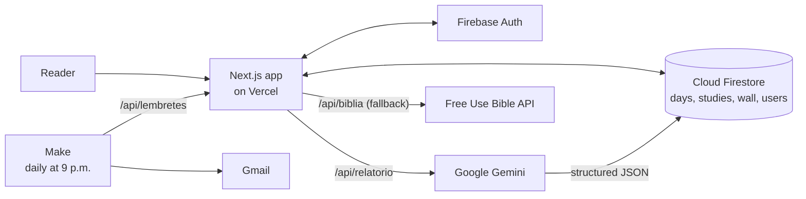
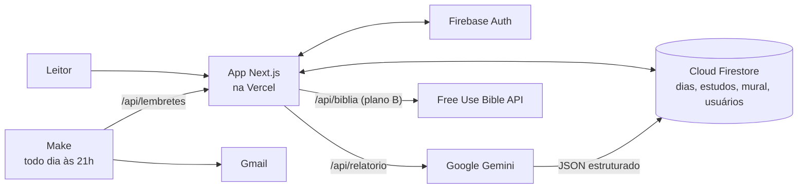

  

### <a href="#english">🇺🇸 English</a> &nbsp;|&nbsp; <a href="#portugues">🇧🇷 Português</a>

 

 

<!-- ======================================================== -->
<!-- ======================= ENGLISH ======================== -->
<!-- ======================================================== -->

# 🇺🇸 English

## 📖 About the project

> *"A daily path through the Scriptures: read, understand and share."*

**Sendas Sagradas** ("Sacred Paths") is a web app for a **guided one-year Bible reading plan**. Each day brings three readings (Old Testament, Psalms/Proverbs and New Testament), the full biblical text, a **study generated with Generative AI** and a **community wall** where readers share verses, words and prayer requests.

The goal is to turn daily reading into a **real moment of study**, with historical context, authorship, peoples, geography and connections across the Bible, all in one place.

 

## ✨ Features

| | Feature | How it works |
|:---:|---|---|
| 📅 | **365-day plan** | Progress tracking, a day grid and personal notes for each day |
| 📜 | **Biblical text for every day** | *Bíblia Livre* (open license), imported into Firestore, with an API fallback |
| 🧠 | **In-depth daily study** | Gemini returns **structured JSON**: historical context, authorship and date, characters, peoples, geography, cross-references, key verse, glossary, applications, reflection questions and a prayer |
| 💾 | **Smart AI caching** | Each day's study is generated **once** and shared by all users (at most 365 calls a year) |
| 💬 | **Community wall** | Real-time posts (verse, word, prayer request, testimony), 🙏 "Amen" reactions, filters and moderation |
| 🔔 | **Daily reminder** | Make runs every day at 9 p.m. and e-mails only the readers who **haven't read yet** that day |
| 🔐 | **Security** | Firestore Security Rules validate each post, protect user data and keep secret keys on the server |

 

## 🛠️ Tech Stack

<table>
<tr>
<td width="50%" valign="top">

### 💻 Front-end

</td>
<td width="50%" valign="top">

### ☁️ Back-end & Data

</td>
</tr>
<tr>
<td width="50%" valign="top">

### 🤖 AI

</td>
<td width="50%" valign="top">

### 🚀 Deploy & Automation

</td>
</tr>
</table>

 

## 🧭 Architecture

 

## 🧠 What I learned

| Concept | In this project |
|---|---|
| 🎯 **Prompt Engineering** | A prompt that asks for historical care and signals tradition vs. hypothesis |
| 🧩 **Structured Output** | A JSON schema so the AI response always renders correctly |
| 💾 **Caching / cost control** | Store AI results in Firestore and reuse them for every user |
| 🔐 **Security Rules** | Validate post content and limit each user to their own data |
| 🔑 **Secret management** | API keys only on the server, through environment variables |
| ⚙️ **Workflow automation** | A scheduled no-code scenario calling a protected endpoint |
| ⚖️ **Licensing & LGPD** | An open-license Bible translation with attribution, plus opt-in for e-mail reminders |

 

<a href="#portugues">🇧🇷 Ler em Português</a> &nbsp;|&nbsp; <a href="#english">⬆️ Back to top</a>

 

---

 

<!-- ======================================================== -->
<!-- ====================== PORTUGUÊS ======================= -->
<!-- ======================================================== -->

# 🇧🇷 Português

## 📖 Sobre o projeto

> *"Um caminho diário pelas Escrituras: ler, entender e compartilhar."*

O **Sendas Sagradas** é um app web de **leitura bíblica guiada em um ano**. Cada dia traz três leituras (Antigo Testamento, Salmos/Provérbios e Novo Testamento), o texto bíblico completo, um **estudo gerado com IA Generativa** e um **mural da comunidade**, onde os leitores compartilham versículos, palavras e pedidos de oração.

O objetivo é transformar a leitura diária em um **momento real de estudo**, com contexto histórico, autoria, povos, geografia e conexões com o resto da Bíblia, tudo em um só lugar.

 

## ✨ Funcionalidades

| | Funcionalidade | Como funciona |
|:---:|---|---|
| 📅 | **Plano de 365 dias** | Acompanhamento do progresso, grade de dias e anotações pessoais em cada dia |
| 📜 | **Texto bíblico em cada dia** | *Bíblia Livre* (licença aberta), importada para o Firestore, com uma API como plano B |
| 🧠 | **Estudo aprofundado do dia** | O Gemini devolve um **JSON estruturado**: contexto histórico, autoria e data, personagens, povos, geografia, conexões bíblicas, versículo-chave, glossário, aplicações, perguntas para reflexão e uma oração |
| 💾 | **Cache inteligente da IA** | O estudo de cada dia é gerado **uma única vez** e compartilhado entre todos (no máximo 365 chamadas por ano) |
| 💬 | **Mural da comunidade** | Posts em tempo real (versículo, palavra, pedido de oração, testemunho), reações 🙏 "Amém", filtros e moderação |
| 🔔 | **Lembrete diário** | O Make roda todo dia às 21h e envia e-mail só para quem **ainda não leu** naquele dia |
| 🔐 | **Segurança** | As Security Rules do Firestore validam cada post, protegem os dados dos usuários e as chaves secretas ficam só no servidor |

 

## 🛠️ Tecnologias

<table>
<tr>
<td width="50%" valign="top">

### 💻 Front-end

</td>
<td width="50%" valign="top">

### ☁️ Back-end e Dados

</td>
</tr>
<tr>
<td width="50%" valign="top">

### 🤖 IA

</td>
<td width="50%" valign="top">

### 🚀 Deploy e Automação

</td>
</tr>
</table>

 

## 🧭 Arquitetura

 

## 🧠 O que aprendi

| Conceito | Neste projeto |
|---|---|
| 🎯 **Prompt Engineering** | Prompt que pede cuidado histórico e diferencia tradição de hipótese |
| 🧩 **Saída estruturada** | Um schema JSON para a resposta da IA sempre aparecer certinha na tela |
| 💾 **Cache e controle de custo** | Guardar o resultado da IA no Firestore e reaproveitar para todos os usuários |
| 🔐 **Security Rules** | Validar o conteúdo dos posts e limitar cada usuário aos próprios dados |
| 🔑 **Gestão de segredos** | Chaves de API só no servidor, por variáveis de ambiente |
| ⚙️ **Automação de workflows** | Cenário no-code agendado chamando um endpoint protegido |
| ⚖️ **Licenças e LGPD** | Tradução bíblica de licença aberta com atribuição, e lembrete por e-mail só com opt-in |

 

## 📜 Créditos

Texto bíblico: **Bíblia Livre (BLIVRE)** © Diego Santos, Mario Sérgio e Marco Teles, licença Creative Commons Atribuição. Fornecido pela [Free Use Bible API](https://bible.helloao.org).

 

## 👩‍💻 Autora

Feito com 💖 por **Amanda Pasqualotto**

  

<a href="#english">🇺🇸 Read in English</a> &nbsp;|&nbsp; <a href="#portugues">⬆️ Voltar ao topo</a>

